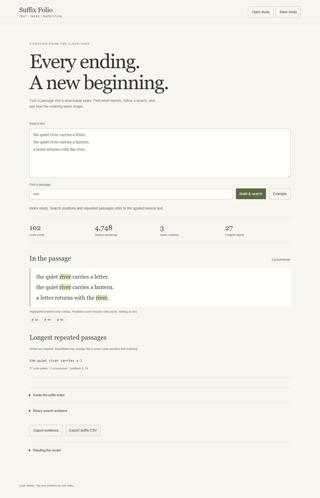

# Suffix Folio

A text-indexing workbench with suffix-array construction, exact substring search, longest repeated passages, and inspectable algorithm evidence. The quiet reading-room interface keeps construction tables and search decisions behind expandable sections.



## Run

```sh
python run.py --port 8000
```

Open http://127.0.0.1:8000 in a modern browser supporting module workers. Python 3.10+ serves static files, Node 22+ runs tests, and the app has no package dependencies or network uploads.

## Features

- Index up to 12,000 Unicode code points; search a nonempty query of up to 256 code points.
- Highlight every match, including overlapping occurrences. All indices count code points from zero, not UTF-16 units or grapheme clusters.
- Find every longest-repeat tie and count distinct nonempty substrings.
- Inspect prefix-doubling rounds, equivalence ranks, final suffix order, and adjacent longest-common-prefix lengths. Tables paginate in groups of 30.
- Follow both binary searches, including their half-open bounds, midpoints, text positions, and comparison results.
- Save/open JSON studies; export full construction/search evidence and a suffix CSV. Editing inputs disables result exports until a successful rebuild.

The [example](docs/example.json) has 102 code points, 4,748 distinct substrings, three occurrences of `river` at 10, 44, and 95, and a 27-code-point longest repeat beginning at 0 and 34. The repeated passage ends partway through a word: this is substring analysis, not token matching.

## Implementation

Each suffix is represented by its starting index. Prefix doubling sorts pairs of current ranks with a below-alphabet sentinel for an exhausted suffix, then assigns new equivalence classes. Comparison sorting gives O(n log² n) construction; storing all rounds uses O(n log n) space. Kasai's algorithm computes LCP in O(n). Distinct substring count is `n(n+1)/2 - sum(LCP)`.

Two binary searches compare the query to suffix prefixes in O(m log n) character comparisons. Equal comparison means the complete query is a prefix, so the resulting interval includes all matching suffixes. Positions are then sorted into text order. Repeats come from contiguous groups attaining the maximum LCP, allowing overlap.

Collation compares numeric Unicode code points. Matching preserves case and normalization; visually identical composed/decomposed text can differ. Unpaired UTF-16 surrogates are rejected. Empty source text is valid; empty query is not. No locale sorting, stemming, fuzzy search, incremental updates, persistent index, or document database is provided.

The source and results stay in browser memory. Imports contain exactly `{text, query}` and are capped at 200 KB. Save study preserves the applied model when results are current, or saves current input fields after edits. Imported line endings remain in the applied model; editing/submitting the browser textarea normalizes CRLF to LF. Evidence contains source text, so review it before sharing.

The UI previews at most 200 occurrence badges and 50 longest-repeat ties, with full results retained in evidence. Suffix previews show 70 code points; visible newline/tab symbols are display substitutions only. The CSV includes rank, start position, LCP, and query membership rather than duplicating every suffix string.

## Verification

```sh
npm test
npm run check
python -m unittest discover -s tests -v
```

Six JavaScript tests include 400 random Unicode texts checked against exhaustive suffix, substring, longest-repeat, LCP, and occurrence oracles; construction-rank checks; numeric-code-point ordering; overlap; empty input; and maximum-size repetitive text. The Python server test checks asset allowlisting, Host validation, and HEAD semantics. CI runs Linux Node 22/24 and Windows Node 24.

Browser verification covered construction paging, Unicode overlap, stale export disabling, empty/oversized text, recovery, study import, and JSON/CSV downloads. Independent Python reconstruction verified all 102 example suffixes, LCP lengths, 4,748 distinct substrings, query positions, longest-repeat length, and CSV rows.

Algorithm background: Princeton's [suffix arrays](https://algs4.cs.princeton.edu/63suffix/) material explains adjacent-suffix repetition analysis. The code here is an independent implementation with explicit Unicode and bounded-input behavior.
